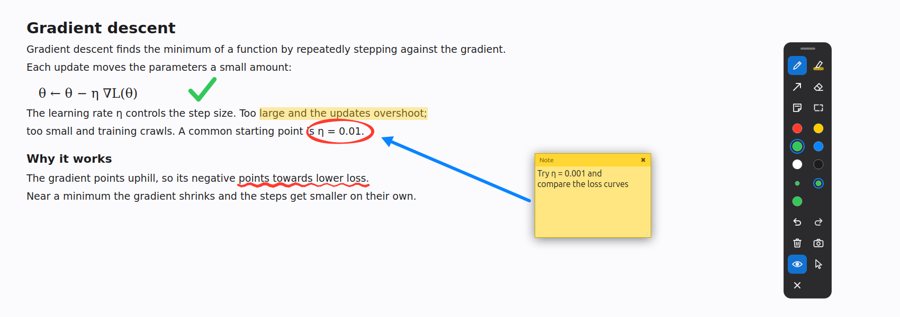
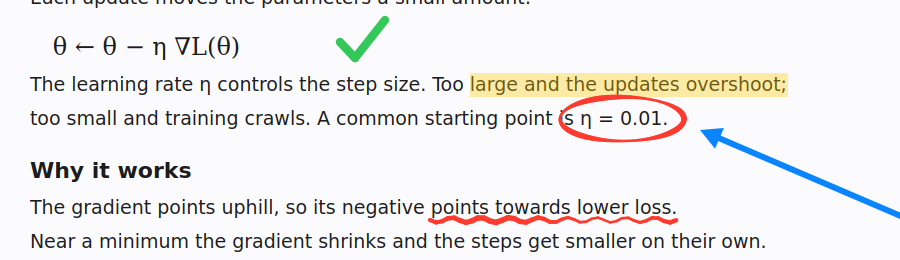
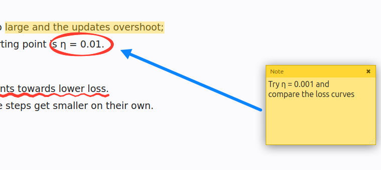
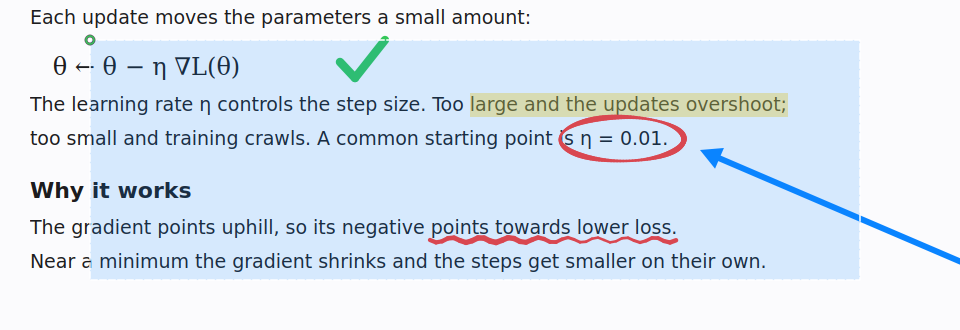
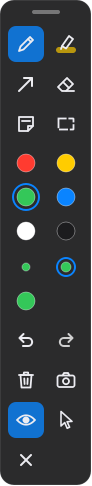

# Draw app

Draw over any app on Linux with a pen tablet. Touch the pen to the tablet and
you are drawing on top of whatever is on screen. There is nothing to open and
no hotkey to press first.

Use it to explain things while screen-sharing or recording, to mark up a PDF,
web page or design, or to take an annotated screenshot and send it to someone.



## Features

- **Opens on pen touch.** The app runs quietly in the tray, and the toolbar
  appears the moment the pen tip touches the tablet.
- **Pen** with pressure sensitivity, plus a **highlighter** that stays even
  where a stroke crosses itself.
- **Arrows** for pointing things out, and an **eraser** that removes whole
  strokes.
- **Sticky notes** you type into, move and resize.
- **Screenshots** of the whole screen or a region you drag out with the pen.
  Ink and notes are included; each shot is saved as a PNG and copied to the
  clipboard.
- **Undo, redo, clear, and hide ink** without losing it.
- **Your mouse keeps working.** Mouse clicks always pass through the ink to
  the app underneath. A pen side button turns the pen into a mouse when you
  need one.
- **Fail-safe.** If the app quits or crashes, the pen goes straight back to
  being a normal mouse.

### Pen and highlighter

Strokes get thicker as you press harder. The highlighter is wide and
see-through, so the text underneath stays readable.



### Arrows and sticky notes

Drag with the arrow tool to point at something. Tap with the note tool to drop
a note, then type into it with the keyboard.



### Region screenshot

Pick the region tool and drag over the part of the screen you want. The shot
includes your ink and notes, is saved as a PNG, and is copied to the clipboard.



### Toolbar



From the top: drag handle; pen, highlighter, arrow, eraser, sticky note and
region screenshot; six colours; three sizes; undo and redo; clear all ink and
full-screen screenshot; show or hide ink and mouse mode; hide the toolbar.

Drag the handle to move the toolbar anywhere on screen. Hover over a button to
see what it does.

<br clear="right">

## Requirements

- Linux with an **X11** session. Wayland is not supported, because Wayland
  does not let an app take over the pen.
- A pen tablet that Linux recognises as a pen with pressure. It was developed
  on a Huion H950P; Wacom, XP-Pen, Gaomon and similar tablets should work too.
- Python 3.12 or newer. The `.deb` targets Ubuntu 24.04 or later.

On Ubuntu, if you are on Wayland, log out, click the gear icon on the login
screen and choose **Ubuntu on Xorg**.

## Install

### From a .deb (Ubuntu / Debian)

Build the package, then install it:

```bash
git clone https://github.com/aman0044/linux_draw_overlay_tool.git draw_app
cd draw_app
packaging/build_deb.sh            # for this machine; or pass amd64 / arm64
sudo apt install ./dist/drawapp_*.deb
```

Then start it with `drawapp`, or pick **Draw app** from the app menu. To start
it at every login, run `drawapp --install-autostart`.

The package brings its own copy of Qt (under `/opt/drawapp`) and uses the
system `python3`. Remove it with `sudo apt remove drawapp`.

Building needs [uv](https://docs.astral.sh/uv/) and `dpkg-deb`. You can build
an `amd64` package on an `arm64` machine and the other way round.

### From source

```bash
git clone https://github.com/aman0044/linux_draw_overlay_tool.git draw_app
cd draw_app
uv run drawapp                    # installs dependencies on first run
uv run drawapp --install-autostart
```

## Using the pen

| Do this | Result |
| --- | --- |
| Touch the tip to the tablet | Draw with the current tool; the toolbar appears |
| Hold the lower side button | The pen acts as a mouse while you hold it |
| Press the upper side button | Toggle mouse mode on or off |
| Move the pen over the toolbar or a note | The pen acts as a mouse there automatically |

The **×** at the bottom of the toolbar hides it; touch the pen to bring it
back. Ink stays on screen until you undo, erase or clear it.

The tray icon menu can pause pen capture, which makes the pen a normal mouse
until you resume. The same menu closes all notes and quits the app.

## Keyboard shortcuts

These work while any app has focus.

| Keys | Action |
| --- | --- |
| Ctrl+Alt+Z / Ctrl+Alt+Y | Undo / redo |
| Ctrl+Alt+X | Clear all ink |
| Ctrl+Alt+H | Show or hide ink and notes |
| Ctrl+Alt+P | Screenshot the whole screen |
| Ctrl+Alt+M | Toggle mouse mode |

Screenshots go to `~/Pictures/Screenshots/` by default.

## Settings

Settings are optional. Create `~/.config/drawapp/config.toml` with any of
these keys:

```toml
device_pattern = "huion"      # regex on the device name; empty = first pen found
tip_button = 1
hold_button = 2               # held: pen acts as a mouse
latch_button = 3              # pressed: toggle mouse mode
colors = ["#ff3b30", "#ffcc00", "#34c759", "#0a84ff", "#ffffff", "#1c1c1e"]
sizes = [3, 6, 12]
highlighter_scale = 4.0       # highlighter width = size × this
highlighter_opacity = 0.35
eraser_radius = 14
screenshot_dir = "~/Pictures/Screenshots"

[hotkeys]
undo = "Ctrl+Alt+Z"
redo = "Ctrl+Alt+Y"
clear = "Ctrl+Alt+X"
toggle_ink = "Ctrl+Alt+H"
screenshot = "Ctrl+Alt+P"
toggle_mouse_mode = "Ctrl+Alt+M"
```

Restart the app after you change the file.

## Troubleshooting

**The side buttons do the wrong thing.** Pens number their buttons
differently. Run `drawapp --debug`, press each button, and put the logged
numbers into `hold_button` and `latch_button`.

**"No pen found".** Check the tablet is plugged in and that
`xinput list` shows a pen device. If you have more than one tablet, or the
wrong device is picked, set `device_pattern` to part of the right device's
name.

**A shortcut does nothing.** Another program already uses that key
combination; the log says so at start-up. Pick a different combination under
`[hotkeys]`.

**The screen stays awake.** A pen lying on or near the tablet keeps sending
small movements, and Linux counts those as activity whether this app runs or
not. Put the pen away from the tablet when you leave.

**"drawapp is already running".** Only one copy runs at a time. Use the tray
icon to quit the running one.

## How it works

The app takes exclusive control of the pen device through XInput2, so the
pen stops moving the system cursor and its events (position, pressure,
buttons) go only to the app. Ink is painted on a full-screen, transparent,
always-on-top window that has no input area, so mouse clicks fall straight
through it. When the pen should act as a mouse, the app replays its
movement and clicks onto the system cursor with XTest. X releases the pen
automatically if the app exits, which is why a crash never leaves you
without a working pen.

## Limitations

- X11 only; no Wayland support.
- Primary monitor only.
- Ink stays where you drew it; it does not follow scrolling or moving
  windows.
- Tablet express keys are not used.
- No Windows or macOS version.

## Development

```bash
uv run pytest                  # unit tests
uv run drawapp --debug         # run with verbose logging
```

```
src/drawapp/
  pen/        find, capture and decode the pen; draw-or-mouse decisions
  model/      strokes, arrows, undo/redo
  ui/         overlay window, toolbar, sticky notes, tray icon
  tools.py    turns pen strokes into edits for the selected tool
  hotkeys.py  global keyboard shortcuts
  screenshot.py
packaging/    .deb build script, desktop entry and icon
tests/        unit tests for the parts that need no display
docs/images/  README screenshots; regenerate with make_screenshots.py
spikes/       throwaway feasibility scripts kept for reference
```

The design notes are in
[`docs/superpowers/specs/2026-10-10-pen-overlay-design.md`](docs/superpowers/specs/2026-10-10-pen-overlay-design.md).

Issues and pull requests are welcome. Please run `uv run pytest` before
sending a change, and say which tablet and distribution you tested on.

## License

No license has been chosen yet. Until one is added, all rights are reserved.
